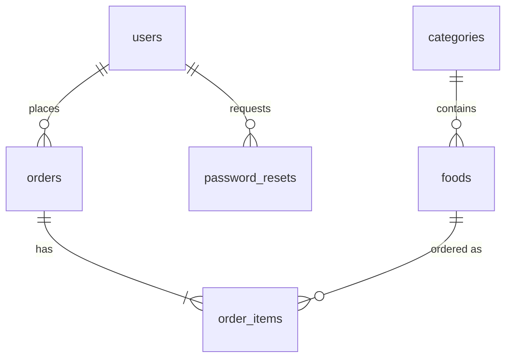

# Rasoi Express - Food Ordering System

Real-World Full Stack Project (ApexPlanet Internship, Task 4). Built with **PHP 8, MySQL, Bootstrap 5, JavaScript, Chart.js**.

## Features
**Customers**
- Register, login, logout, forgot/reset password
- Menu with search, category and veg filters, sorting and pagination
- Cart, checkout (COD/UPI), order history, order detail, cancel pending orders
- Dashboard with order stats and favourite dishes
- Profile with picture upload and password change

**Admin panel**
- Dashboard: revenue, orders, pending orders, customers, active users (7 days), orders per day chart, orders by status chart, top dishes
- CRUD for dishes (with photo upload) and categories
- Order management with status updates and delete confirmation
- User management: search, change role, block/unblock, delete

## Security
- PDO prepared statements everywhere (SQL injection)
- `password_hash()` / `password_verify()`, strong password rule
- CSRF token on every POST form
- Output escaped with `htmlspecialchars` (XSS)
- `session_regenerate_id()` on login and password change; HttpOnly + SameSite cookies
- Role-based access (`require_admin()`), blocked users cannot log in
- Login throttling after 5 failed attempts
- Image upload checks: size limit, real MIME type (finfo), `getimagesize`, random file names, script execution disabled in `uploads/`
- Order prices are read from the database at checkout, never from the browser
- Reset tokens stored as SHA-256 hashes, expire in 30 minutes, single use

## Setup (XAMPP / WAMP)
1. Copy this folder to `htdocs/rasoi`.
2. Start Apache and MySQL.
3. Open phpMyAdmin and import `database.sql` (creates the `rasoi_express` database with sample data).
4. Check `config/config.php` (DB user/password, `BASE_URL` = `/rasoi`).
5. Visit `http://localhost/rasoi/`.

The pages load Bootstrap, Bootstrap Icons and Chart.js from a CDN, so an internet connection is needed.

## Demo accounts
| Role | Email | Password |
|------|-------|----------|
| Admin | admin@rasoi.test | Admin@123 |
| Customer | demo@rasoi.test | User@123 |
| Shop Owner | shop@rasoi.test | Shop@123 |

## Database
Tables: `users`, `categories`, `foods`, `orders`, `order_items`, `password_resets`. Foreign keys with indexes on every lookup column (see `database.sql`).



## Notes
- No mail server on localhost, so the password reset link is shown on screen (demo mode). In production, email it.
- Deleting a dish keeps old orders intact because `order_items` stores the dish name and price at order time.

## Project structure
```
admin/        admin panel pages
assets/       css, js, placeholder image
config/       settings
docs/         requirement document
includes/     db, auth helpers, header, footer
uploads/      avatars and food photos
database.sql  schema + sample data
```

## Demo video outline (10 min)
1. Requirements and ER diagram (1 min)
2. Register, forgot password, login (2 min)
3. Browse, search, filters, cart, checkout (2 min)
4. Orders, dashboard, profile upload (1.5 min)
5. Admin: dashboard, add/edit/delete dish, update order status, manage users (3 min)
6. Security points and GitHub repo (0.5 min)
